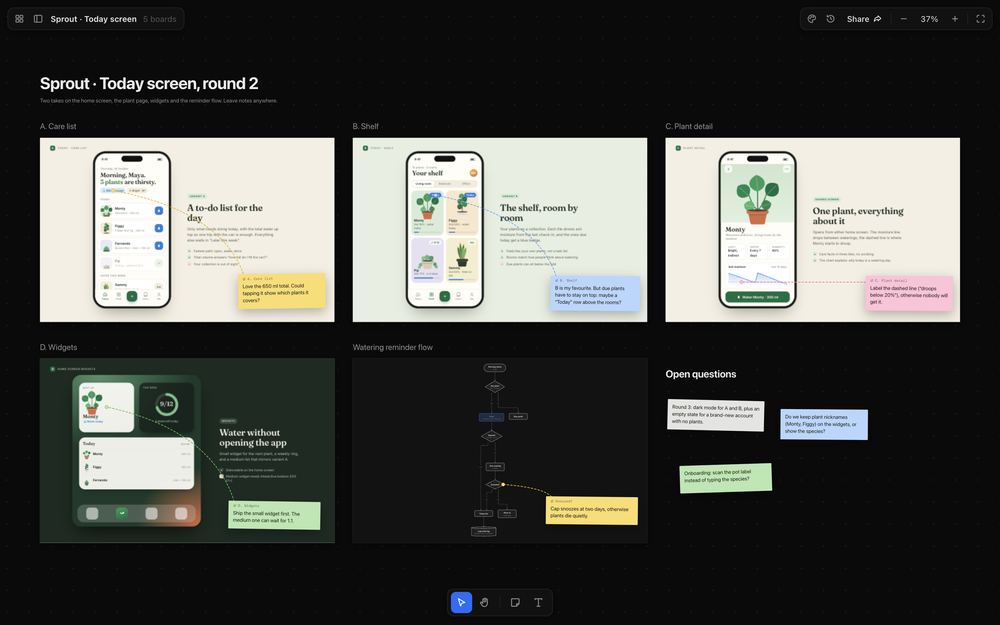
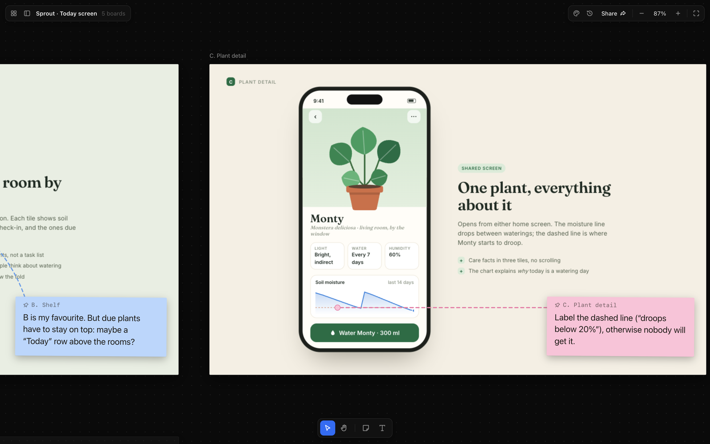
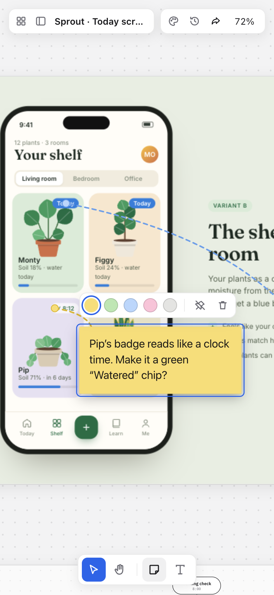
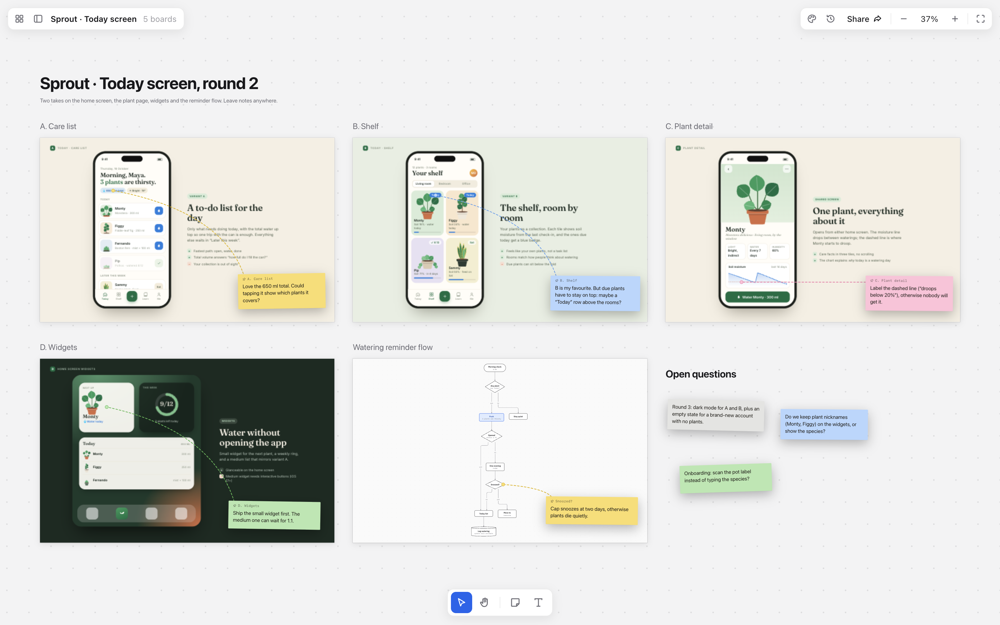
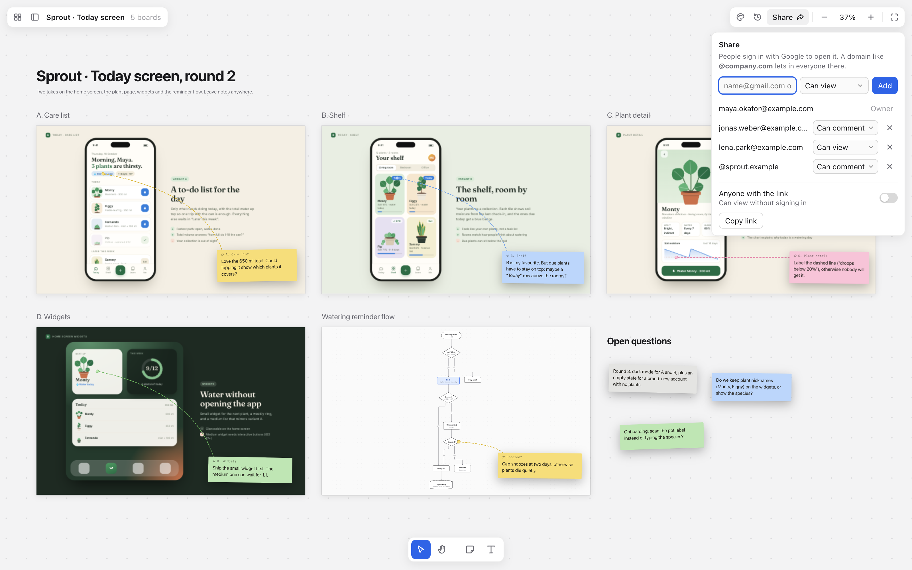
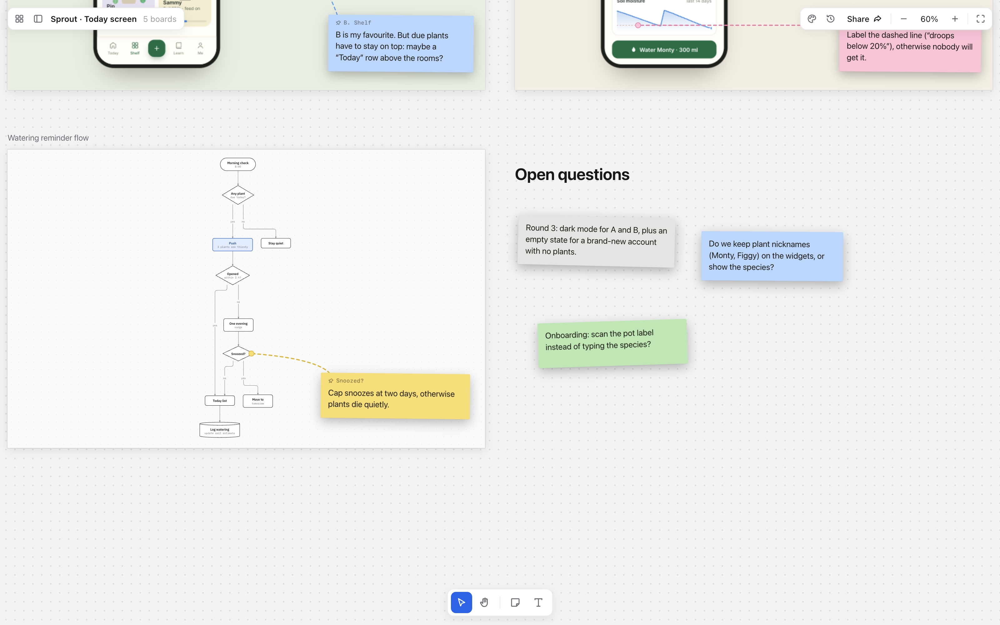
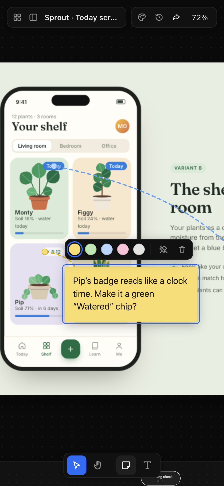

# Draftwall

**A design wall for coding agents.** An agent writes HTML mockups and Mermaid diagrams into a folder. Draftwall lays them out on a zoomable canvas where you compare them side by side and leave sticky notes, on a laptop or a phone. The agent pulls the notes back as text and makes the next round.



<table>
<tr>
<td width="68%"></td>
<td></td>
</tr>
<tr>
<td><sub>Notes can be pinned to a spot on a board or to a diagram node.</sub></td>
<td><sub>The same canvas on a phone, with a new note.</sub></td>
</tr>
</table>

<sub>The screenshots use the made-up "Sprout" canvas in [`examples/demo`](examples/demo). The people and the product are invented.</sub>

## The loop

1. You ask an agent (I use Claude Code) for a screen. It writes each variant as a standalone HTML file, plus `.mmd` files for flows, into a canvas folder.
2. It runs `canvas push <dir>` and gives you the link.
3. You open the link, zoom around and leave sticky notes where something is off: "label the dashed line", "cap snoozes at two days". A note can be pinned to a spot on a board or to a node of a diagram.
4. The agent runs `canvas pull <dir>`. The notes land in `canvas.json` and are printed in a form the agent can act on (abridged):

   ```
   - [n-chart, pink] pinned to "C. Plant detail" (c-plant-detail.html) at 330,627: Label the dashed line ("droops below 20%"), otherwise nobody will get it.
   - [n-snooze] pinned to node "Snoozed?" (id snooze) in "Watering reminder flow" (watering-flow.mmd): Cap snoozes at two days, otherwise plants die quietly.
   ```

5. It edits the boards and pushes again. Your notes stay on the canvas, and every push is kept in History.

A canvas is just a folder of HTML boards plus `canvas.json`. That's the same format Claude Desktop uses for its canvases, so canvases made there open here too.

## Features

- **Zoomable canvas.** Pan and pinch-zoom across any number of boards. Each board is a real HTML page in a sandboxed iframe. It stays live while it's large on screen and switches to a PNG preview when it's small, so big canvases stay smooth on phones.
- **Sticky notes and headings.** Yellow, green, blue, pink and gray notes, pinned to a board or a diagram node or left free. Titles and text right on the canvas. Undo and redo with Cmd+Z / Cmd+Shift+Z.
- **Diagram boards.** A Mermaid file (`*.mmd`: flowchart, sequence, state or ER) becomes a board of its own, laid out with ELK and drawn as SVG. The source opens beside the canvas, and nodes you move by hand stay where you put them.
- **Light and dark.** Follows the system setting, with several color themes in the picker. Diagrams pick up the theme colors.
- **Local mode with live reload.** `canvas serve <dir>` watches the folder, so a board appears as soon as the agent writes it. No account, no server.
- **Hosted mode.** Push a canvas to your own server and sign in with Google. Share it with an email, a whole domain (`@company.com`) or a public link. Members are viewers or editors; editors can also leave notes.
- **History.** Every push and every edit in the viewer is saved as a version you can look at and restore.
- **A CLI for agents.** Every command is non-interactive. The CLI handles several Google accounts and per-folder defaults.

| | |
|---|---|
|  |  |
|  |  |

## Quick start (local)

Requires Node 24.

```sh
git clone https://github.com/SketchPiece/draft-wall.git
cd draft-wall
npm install
npm run local examples/demo     # http://127.0.0.1:4870/c/local
```

For your own canvas, put `.html` (and optionally `.mmd`) files in a folder and run `node bin/canvas.mjs serve <folder>`. New boards are laid out in `canvas.json` automatically, and when you move them in the viewer the layout is saved back. `npm link` puts the CLI on your PATH as `canvas`.

A board is any self-contained HTML page. It can load files that sit next to it (a shared stylesheet, scripts, images). Boards are 1280×800 by default; change `w` and `h` in `canvas.json` for other sizes.

## CLI

```sh
canvas sync    <dir> [--title "…"]     # lay out new boards in canvas.json, keep placed ones
canvas serve   <dir> [--port 4870]     # view locally with live reload
canvas push    <dir> [--id <id>]       # upload to the hosted canvas and print its URL
canvas pull    <dir>                   # bring notes, headings and board positions back, print the notes
canvas thumbs  <id>                    # rebuild board previews for a canvas on the server
canvas share   <dir|id> add <email|@domain> [--role viewer|editor]
canvas share   <dir|id> rm <email|@domain>
canvas share   <dir|id> public on|off
canvas list                            # canvases you can see
canvas rm      <id>
canvas login                           # sign the CLI in with Google; repeat for more accounts
canvas logout  <email>
canvas accounts [--default <email>]
canvas project [<dir>] [--account <email>] [--share "a@b.com:editor,@company.com"|none]
canvas creators [add|rm <email|@domain>]   # admins: who may create canvases
canvas config  --url https://your-draftwall.example.com
```

Add `--as <email>` to any command to act as a specific signed-in account.

`push` keeps notes that were left on the hosted canvas since the last pull, so an agent can't wipe your feedback by pushing an older `canvas.json`. It also renders a PNG preview of every HTML board with your local Chrome (cached in `~/.cache/canvas/thumbs`).

### Using it from an agent

Any agent that can write files and run shell commands can drive Draftwall. Tell it to:

- write each variant as a self-contained HTML file in one folder, and diagrams as `.mmd`;
- run `canvas push <dir>` and send you the URL;
- when you say you've left notes, run `canvas pull <dir>`, address each note, then push again.

I keep these rules in a Claude Code skill that carries a copy of `bin/canvas.mjs`, `src/shared.js` and `web/viewer.html`, so any project can open a canvas.

## How it works

```
 agent / you                     Draftwall
 ───────────                     ─────────
 writes boards ─▶ folder/ ──────▶ canvas serve ─▶ viewer on localhost (live reload)
   a.html          canvas.json
   b.html              └────────▶ canvas push  ─▶ hosted server ─▶ viewer anywhere, shared
   flow.mmd                                             │
                 ◀──── canvas pull ◀── sticky notes, headings, positions
```

- `web/viewer.html` is the canvas viewer, used in both modes. `web/theme.js` (themes and the picker) and `web/diagram.js` (Mermaid parsing and drawing) are inlined into it. `npm run embed` bundles `web/*.html` into `src/generated/pages.ts` for the hosted app.
- `bin/canvas.mjs` is the CLI, including the local server. Boards are served under a strict sandbox CSP and talk to the viewer through a small injected bridge (`src/shared.js`).
- `src/index.ts` is the hosted app ([Hono](https://hono.dev) on Node): Google sign-in (a cookie for the browser, bearer tokens for the CLI), the API for push, pull, layout, history and sharing, and board files under capability URLs.
- `src/access.ts` decides who may do what. A canvas has an owner and members, added by email or by domain. Viewers can look; editors can also move boards, edit headings and leave notes; only the owner can push, share and make a canvas public. Admins own every canvas and choose who may create canvases.
- `src/store.ts` keeps canvases as plain files on disk. `src/history.ts` keeps versions: `history.json`, `versions/<v>.json`, and file copies by hash in `objects/`.

## Self-hosting

The hosted app is one Node process that stores canvases as files, so it runs anywhere with a persistent disk. Mine runs on [Railway](https://railway.com) with a volume mounted at `/data`.

1. Create a Google OAuth client (type: Web application) with the redirect URI `<origin>/auth/google/callback`.
2. Set the environment variables from [`.env.example`](.env.example):
   - `GOOGLE_CLIENT_ID`, `GOOGLE_CLIENT_SECRET`
   - `CANVAS_SECRET`: any long random string; signs sessions, CLI tokens and file keys
   - `CANVAS_ADMINS`: comma-separated admin emails
   - `CANVAS_DATA_DIR`: where canvases live, e.g. `/data` (defaults to `./data`)
   - `PORT`: defaults to 4870
3. Build and start:
   ```sh
   npm install && npm run build && npm start
   ```
4. Point the CLI at it with `canvas config --url https://<your host>`, then run `canvas login`.

### Development

`npm run dev` runs the hosted app on http://localhost:4870 with env from `.env.local`, storing canvases in `./data`. In dev, `/dev/login?email=…` signs you in as anyone, which makes it easy to try the roles. `npm run typecheck` checks the types.

## License

[MIT](LICENSE) © 2026 Andrew Liubkin
