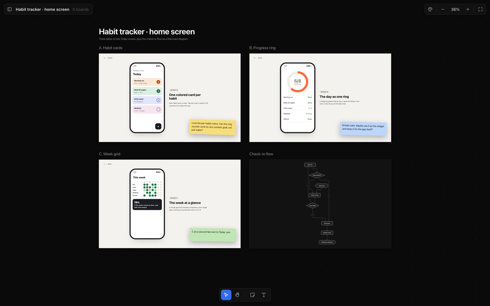

# Draftwall

**A design wall for AI agents.** An agent writes HTML mockups and Mermaid diagrams into a folder. Draftwall lays them out on a zoomable board, where you compare them side by side, leave sticky notes and send the notes back to the agent. You can run it locally with one command, or host it so a canvas also opens on your phone.



<sub>The demo canvas from [`examples/demo`](examples/demo), opened with `npm run local examples/demo`.</sub>

## Why

Coding agents are good at producing UI variants as plain HTML, but a pile of files in a folder is hard to review. Draftwall turns that folder into a canvas. Every board is a live page you can zoom into and every comment is a note pinned next to the design. Everything is stored as plain files, so the agent can read your feedback and iterate.

A canvas is a folder of HTML boards plus `canvas.json`. That's the same format Claude Desktop uses for its canvases, so canvases made there open here too.

## Features

- **Zoomable board.** Pan and pinch-zoom across any number of boards. Each board is a real HTML page in a sandboxed frame. It stays live while it's large on screen and switches to a PNG preview when it's small or far away, so big canvases stay smooth on phones.
- **Sticky notes and headings.** Leave yellow, green or blue notes anywhere and pin them to a spot on a board or to a node of a diagram. Add titles and text right on the canvas. Undo and redo with Cmd+Z / Cmd+Shift+Z.
- **Diagram boards.** A Mermaid file (`*.mmd`: flowchart, sequence, state or ER) in the folder becomes its own board. It's laid out with ELK and drawn as SVG in the Draftwall style. The source opens beside the canvas, and nodes you move by hand stay where you put them.
- **Themes.** Several color themes with light and dark variants. Diagrams pick up the theme colors.
- **Local mode with live reload.** `canvas serve <dir>` watches the folder, so a board appears on the canvas as soon as an agent writes it.
- **Hosted mode.** Push a canvas to your own server and sign in with Google. Share it by email, with a whole domain (`@company.com`) or as a public link. Members are either `viewer`s or `editor`s.
- **History.** Every push, edit and restore is saved as a version. The History panel shows any earlier version and can restore it.
- **CLI built for agents.** Includes `sync`, `serve`, `push`, `pull`, `share`, `list` and more. Every command runs non-interactively. The CLI supports several Google accounts and per-repo defaults.

## Quick start

Requires Node 24.

```sh
git clone https://github.com/SketchPiece/draft-wall.git
cd draft-wall
npm install
npm run local examples/demo     # serves http://127.0.0.1:4870/c/local
```

To make your own canvas, put some `.html` files (and optionally `.mmd` files) in a folder and run `node bin/canvas.mjs serve <folder>`. Boards are laid out automatically in `canvas.json`. When you move them in the viewer, the new layout is saved back. Run `npm link` to put the CLI on your PATH as `canvas`.

## How it works

```
 agent / you                     Draftwall
 ───────────                     ─────────
 writes boards ─▶ folder/ ──────▶ canvas serve ─▶ viewer on localhost (live reload)
   a.html          canvas.json
   b.html              └────────▶ canvas push  ─▶ hosted server ─▶ viewer anywhere, shared
   flow.mmd                                             │
                 ◀──── canvas pull ◀── sticky notes, headings, positions
```

- `web/viewer.html` is the canvas viewer, used in both modes. `web/theme.js` holds the color themes and the theme picker. `web/diagram.js` parses and draws Mermaid. Both are inlined into the viewer. `npm run embed` bundles `web/*.html` into `src/generated/pages.ts` for the hosted app.
- `bin/canvas.mjs` is the CLI, and it includes the local server. Boards are served under a strict sandbox CSP. They talk to the viewer through a small injected bridge (`src/shared.js`).
- `src/index.ts` is the hosted app ([Hono](https://hono.dev) on Node). It handles Google sign-in (a cookie for the browser, bearer tokens for the CLI), serves the API for push, pull, layout and sharing, and serves board files under capability URLs.
- `src/access.ts` decides who may do what. Each canvas has an owner plus members, added by email or by domain:
  - `viewer` members can look.
  - `editor` members can also move boards, edit headings and leave notes.
  - Only the owner can push and share, and only the owner can make a canvas public.
  - Admins own every canvas and choose who may create canvases.
- `src/store.ts` keeps canvases as plain files on disk (a volume in production). `src/history.ts` keeps the versions: `history.json`, `versions/<v>.json`, and file copies by hash in `objects/`.
- `canvas push` makes board previews. It screenshots every HTML board with your local Chrome into `_thumbs/<board>.png`, cached in `~/.cache/canvas/thumbs`. `canvas thumbs <id>` does the same for a canvas that's already on the server.

## Using it from an AI agent

Draftwall was built to be driven by agents. I use it through a Claude Code skill (`canvas`) that carries a copy of `bin/canvas.mjs`, `src/shared.js` and `web/viewer.html`. When I ask for a design, the agent:

1. writes each variant as a self-contained HTML board (and diagrams as `.mmd` files) into a canvas folder,
2. runs `canvas push <dir>` and gives me the link, which I open on my laptop or phone,
3. once I've left sticky notes, runs `canvas pull <dir>`, reads them from `canvas.json` (`annotations`) and iterates on the boards.

Any agent that can write files and run shell commands can do the same. These are the commands you'll use most:

```sh
canvas sync   <dir> [--title "…"]     # lay out new boards in canvas.json
canvas serve  <dir> [--port 4870]     # view locally with live reload
canvas push   <dir> [--id <id>]       # upload to the hosted canvas, print its URL
canvas pull   <dir>                   # bring notes, headings and positions back
canvas share  <dir|id> add <email|@domain> [--role viewer|editor]
canvas share  <dir|id> public on|off
canvas login                          # sign the CLI in with Google (repeat for more accounts)
canvas project <dir> --account <email> --share "a@b.com:editor,@company.com"
canvas config --url https://your-draftwall.example.com
```

## Self-hosting

The hosted app is a single Node process that stores canvases as files, so it runs anywhere with a persistent disk. Mine runs on [Railway](https://railway.com) as a `web` service that deploys from `main`, with a volume mounted at `/data`.

1. Create a Google OAuth client (type: Web application) with the redirect URI `<origin>/auth/google/callback`.
2. Set the environment variables listed in [`.env.example`](.env.example):
   - `GOOGLE_CLIENT_ID` and `GOOGLE_CLIENT_SECRET`
   - `CANVAS_SECRET`
   - `CANVAS_ADMINS` (comma-separated emails)
   - `CANVAS_DATA_DIR` (the volume mount, e.g. `/data`)
3. Build and start the server (`src/server.ts`). It listens on `PORT`, which defaults to 4870:
   ```sh
   npm install && npm run build && npm start
   ```
4. Point the CLI at your server with `canvas config --url https://<your host>`, then run `canvas login`.

### Development

`npm run dev` runs the hosted app on http://localhost:4870 and reads env from `.env.local`. It stores canvases in `./data`. Locally, `/dev/login?email=…` signs you in as anyone, which makes it easy to try the roles. Run `npm run typecheck` to check the types.

`scripts/migrate-blob.ts` is a one-off script. It copied canvases from an earlier Vercel Blob store onto the disk.

## License

[MIT](LICENSE) © 2026 Andrew Liubkin
